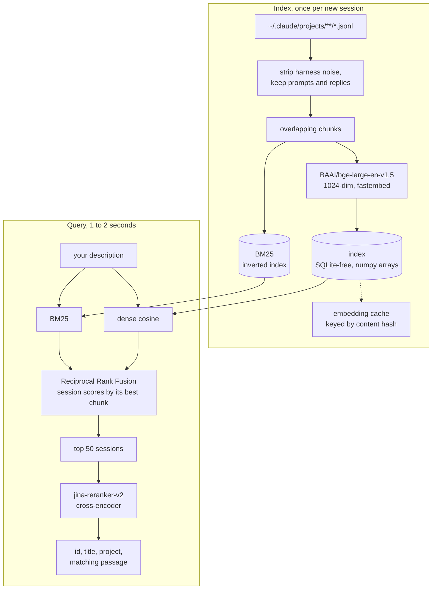

# cc-session-search

Search your old Claude Code sessions by what you remember them being about, not by the words you
happen to type. You get the session ID and a `claude --resume` line you can paste.

Everything runs on your machine. No API calls, no server, no telemetry. The models ship as
weights you download once.

## The problem

Claude Code stores every session under `~/.claude/projects/**/*.jsonl`. Those files are large,
undated in any useful way, and named after a project directory you have since renamed. Keyword
search fails on the obvious query, because what you remember is "that session where I fixed the
timezone bug in the invoice PDF", and the transcript says "the date came out a day early".

Meaning-based retrieval is the right tool and it is entirely doable locally on an M-series laptop.

## How it works



Retrieval runs twice on purpose. The cheap stage has to be generous because chunk embeddings
misfire on short queries; the expensive stage only ever sees 50 candidates, which is why the whole
round trip still lands under two seconds. Reciprocal Rank Fusion merges the two rankings without
asking which one is better, because on any given query neither is.

Embeddings are keyed by a hash of the chunk text, so reindexing only embeds what is genuinely new.
A cold start downloads about 2.3 GB of model weights once. After that, indexing a few thousand
chunks takes minutes and a query takes one to two seconds.

`DECISIONS.md` records why each piece exists, including the alternatives that lost.

## Use it

```bash
git clone https://github.com/asadtariq96/cc-session-search.git
cd cc-session-search
./ccsearch                 # reindex new sessions, then open http://127.0.0.1:8422
```

`ccsearch` is a four-line shell wrapper so you can put it on `PATH`:

```bash
echo "alias ccsearch='$PWD/ccsearch'" >> ~/.zshrc
```

Underneath it is a single command with subcommands if you would rather drive it yourself:

| Command | Effect |
| --- | --- |
| `uv run python app.py index` | Rebuild the index |
| `uv run python app.py serve` | Serve the page, no reindex |
| `uv run python app.py serve --reindex` | Reindex, then serve |
| `uv run python app.py serve --port 9000` | Pick a port |
| `uv run python app.py serve --no-open` | Do not open a browser |

Requirements are `uv` and Python 3.12. The only Python dependencies are `fastembed` and `numpy`;
there is no framework and no database.

## What a result gives you

The Claude-generated title, the opening prompt, the project directory, the git branch, the date,
and the message count, plus three actions:

- copy the resume command, `cd "<cwd>" && claude --resume <id>`
- copy the bare session ID
- open it in a new iTerm2 tab, best effort

## Limits

Indexing reads whatever is on disk, so a session you deleted stays searchable until the next
rebuild. The cross-encoder rerank is the slow half of a query, which is the price of the second
stage being useful at all. There is no incremental delete.
